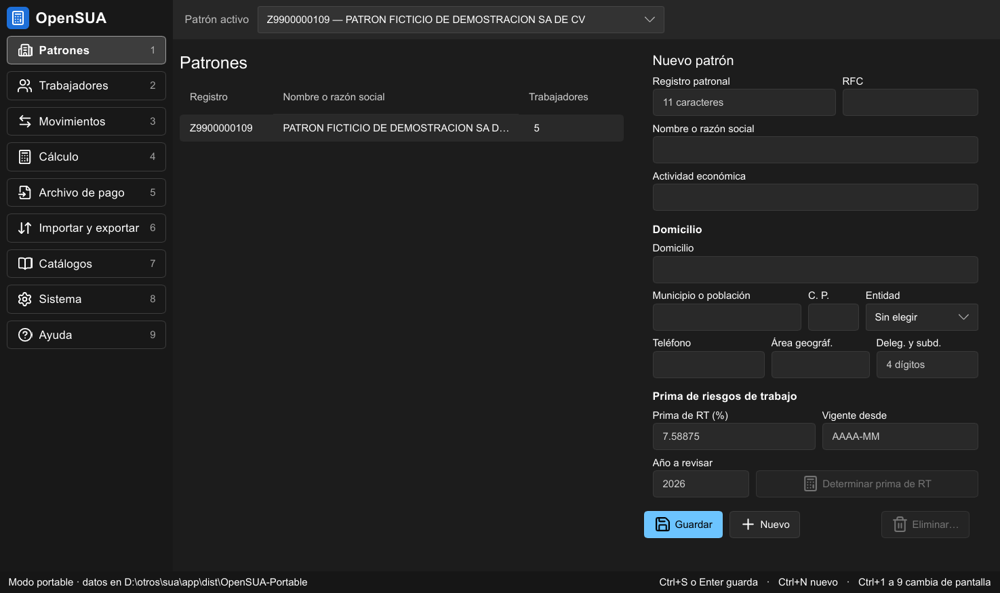
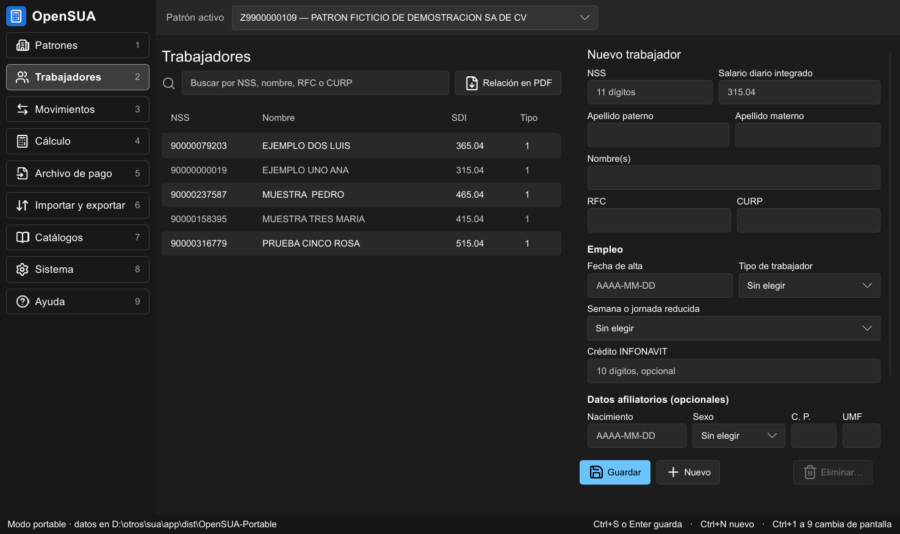
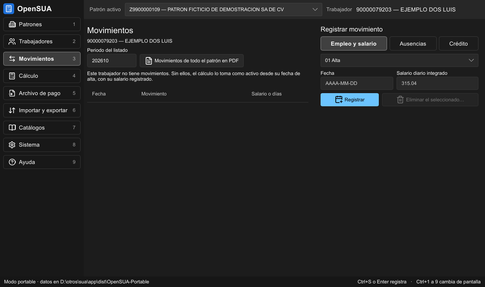
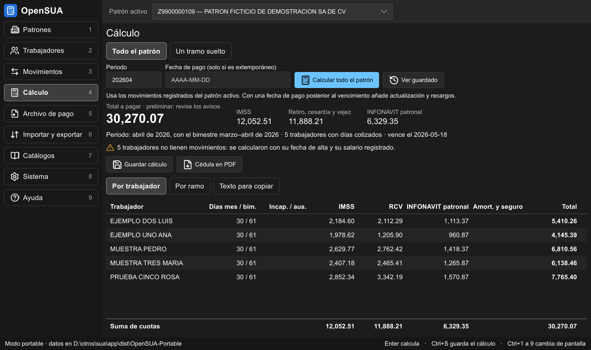
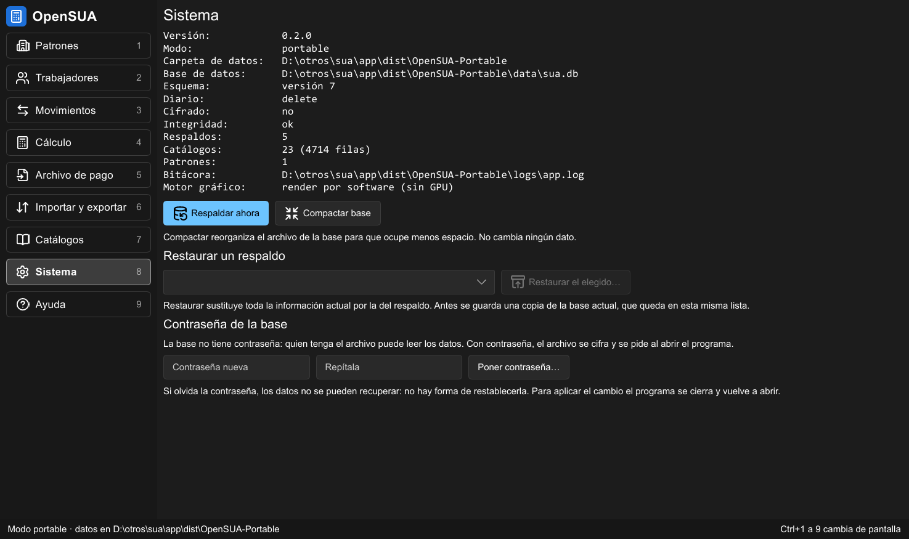

# Qué es y qué no es

OpenSUA calcula las cuotas obrero‑patronales del IMSS, las aportaciones de retiro, cesantía y vejez, y las aportaciones y amortizaciones del INFONAVIT, a partir de los trabajadores y movimientos que usted captura o importa.

**No sustituye al SUA oficial del IMSS.** No genera el archivo de pago ni la línea de captura; para pagar sigue haciendo falta el SUA oficial. Sirve para llevar la captura, revisar un archivo de pago ya generado, anticipar cuánto se va a pagar y tener una cédula de trabajo en PDF.

Los cálculos se comprobaron contra archivos de pago reales de 2006 a 2008. Las reglas de años posteriores (base en UMA, cesantía patronal por rangos, créditos, recargos) salen de la ley y del manual del SUA, sin un caso real que las confirme. **Revise siempre el resultado antes de usarlo.**

# Empezar

1. Copie la carpeta `OpenSUA-Portable` completa a donde quiera: el disco, una memoria USB o una carpeta de red. No se instala y no pide permisos de administrador.
2. Abra `sua.exe`.

La primera vez Windows puede mostrar el aviso «Windows protegió su PC», porque el ejecutable no está firmado: elija **Más información** y después **Ejecutar de todas formas**.

Todo lo que captura queda dentro de esa misma carpeta:

| Carpeta | Contenido |
|---|---|
| `data` | La base de datos (`sua.db`) y los respaldos (`data\respaldos`) |
| `reportes` | Los PDF que genera |
| `archivos` | Los TXT que exporta, en una carpeta por registro patronal |
| `logs` | La bitácora del programa |
| `config` | `settings.toml`. No lo borre: indica que el programa trabaja en modo portable |

Para llevarse el trabajo a otro equipo, cierre el programa y copie la carpeta entera.

No se pueden abrir dos copias del programa sobre la misma carpeta de datos: la segunda avisa y se cierra.

## Si la carpeta no se puede escribir

Si la memoria USB está protegida contra escritura o la carpeta es de solo lectura, el programa avisa y pregunta si quiere elegir otra carpeta para los datos. En la carpeta que elija crea una llamada `SUA-datos`. La pregunta se repite cada vez que abre el programa.

# El orden de trabajo

La ventana tiene el menú a la izquierda y, arriba, el **patrón activo**: Trabajadores, Movimientos, Cálculo e Importar y exportar trabajan siempre sobre ese patrón.

## 1. Patrones

Registre al patrón con su registro patronal (11 caracteres), RFC, nombre, domicilio y entidad. En **Prima de riesgos de trabajo** escriba el porcentaje y el mes desde el que rige (la prima se revisa cada año y rige de marzo a febrero). Sin prima vigente, el cálculo lo avisa.

Elegir un renglón de la lista carga al patrón en el formulario y lo vuelve el patrón activo. Un patrón que ya tiene trabajadores no se puede eliminar: su historial se conserva.

## 2. Trabajadores

Capture a cada trabajador con su NSS, nombre, salario diario integrado y fecha de alta. El programa revisa el dígito verificador del NSS y de la CURP mientras escribe; en el RFC un dígito que no coincide es solo una advertencia. Los datos afiliatorios son opcionales.

El buscador filtra por NSS, nombre, RFC o CURP. **Relación en PDF** saca la lista de trabajadores del patrón.

Si ya tiene a los trabajadores en el SUA oficial, es más rápido traerlos que capturarlos: vea «Traer datos del SUA oficial».

## 3. Movimientos

Elija primero a un trabajador en la pantalla Trabajadores. Aquí se registra lo que le pasó:

| Movimiento | Qué pide |
|---|---|
| Baja, reingreso, modificación de salario | Fecha y, salvo en la baja, el salario nuevo |
| Ausentismo | Fecha y días (de 1 a 7; no más de 7 en el mes) |
| Incapacidad | Fecha, días y folio (dos letras y seis números). Los datos médicos son opcionales; hacen falta para la prima de riesgos de trabajo |
| Crédito INFONAVIT | Inicio, suspensión, reinicio y cambios de tipo, valor o número |

El programa no deja registrar movimientos que no tienen sentido: una baja de quien ya está dado de baja, una incidencia en días en que el trabajador no está activo, o dos incidencias que se enciman.

## 4. Cálculo

Escriba el periodo como año y mes (`202602` es febrero de 2026) y pulse **Calcular todo el patrón**. En los meses pares se suma el bimestre: retiro, cesantía y vejez, e INFONAVIT.

- El resultado muestra el total, los rubros y el detalle **por trabajador** o **por ramo**. **Texto para copiar** lo da en texto para pegarlo en otro lado.
- **Lea los avisos**: dicen, por ejemplo, si faltan los valores del año, si un trabajador no tiene movimientos o si algún movimiento no se pudo aplicar.
- Si escribe una **fecha de pago** posterior al vencimiento (el día 17 del mes siguiente, o el siguiente día hábil), se añaden actualización y recargos. Para eso deben estar capturados el INPC y la tasa de recargos de los meses que correspondan (Catálogos, INPC).
- **Guardar cálculo** conserva el resultado tal como está; no cambia aunque después cambie la captura. **Ver guardado** lo vuelve a mostrar.
- **Cédula en PDF** genera la cédula de determinación de cuotas en la carpeta `reportes` y la abre. Es un documento de trabajo, no un comprobante de pago.

**Un tramo suelto** calcula las cuotas de un salario y un número de días, sin trabajador: sirve para hacer una cuenta rápida.

# Traer datos del SUA oficial

## Archivo de pago

Abre un archivo de pago `.SUA` generado por el SUA oficial. El programa:

- muestra los totales por ramo;
- verifica que el archivo cuadre por dentro (sumas, conteos y tamaño);
- **recalcula las cuotas y las compara** con las del archivo, importe por importe;
- puede **importar** al patrón, a los trabajadores y sus movimientos. Antes de importar hace un respaldo.

## Importar y exportar

Lee y escribe los archivos de texto de ancho fijo del SUA: patrones, trabajadores, movimientos, créditos INFONAVIT, datos afiliatorios e incapacidades.

- Al **importar** se hace antes un respaldo. Los renglones que no pasan la validación se listan con su motivo y no detienen a los demás. Volver a importar el mismo archivo actualiza y no duplica.
- Al **exportar** se escriben los datos del patrón activo en `archivos\<registro patronal>\`.

Los archivos exportados y los PDF **contienen datos personales y no van cifrados**: cuide dónde los copia.

# Catálogos

Muestra los catálogos con los que calcula el programa (salarios mínimos, UMA, UMI, tasas, días inhábiles y otros), con un buscador.

Dos cosas requieren su atención:

- **INPC y recargos.** El catálogo llega a enero de 2026. Los meses siguientes se capturan aquí, eligiendo `INPC`; hacen falta para calcular pagos extemporáneos.
- **Valores de cada año.** Salario mínimo, UMA y UMI están cargados hasta 2026. Para 2027 en adelante hace falta una versión nueva del programa; mientras tanto, el cálculo avisa que faltan.

# Sistema y respaldos

- **Respaldar ahora** copia la base a `data\respaldos`. Se conservan los 10 respaldos más recientes. El programa hace además un respaldo por su cuenta antes de importar, de restaurar y de actualizar la base a una versión nueva.
- **Restaurar el elegido** sustituye toda la información actual por la del respaldo. Antes guarda una copia de la base actual, que queda en la misma lista, así que restaurar se puede deshacer.
- **Compactar base** reorganiza el archivo para que ocupe menos. No cambia ningún dato.

Haga un respaldo al terminar cada sesión de captura, y de vez en cuando copie la carpeta `data\respaldos` a otro lugar: un respaldo en la misma memoria USB no sirve si la memoria se pierde.

# Teclado

| Teclas | Qué hacen |
|---|---|
| Ctrl+1 a Ctrl+9 | Cambian de pantalla, en el orden del menú |
| Ctrl+S | Guarda o registra |
| Ctrl+N | Limpia el formulario para un registro nuevo |
| Enter en un campo | Lo mismo que el botón principal de la pantalla |

# Actualizar el programa

Cierre el programa y sustituya `sua.exe` y `sua-cli.exe` por los de la versión nueva. No toque `data` ni `config`. Al abrir, si la base necesita cambios, el programa hace primero un respaldo.

Una base abierta con una versión nueva puede dejar de abrirse con una versión anterior. Pasa con esta versión: al abrir una base de una versión anterior le añade las tablas de usuarios, y ya no abre con las versiones previas.

# Cuidado de los datos

La base contiene nombres, NSS, CURP, RFC y salarios. **Sin contraseña se guarda sin cifrar:** quien tenga el archivo puede leerla. Si lleva el programa en una memoria USB, póngale contraseña a la base (siguiente apartado) o guarde la memoria en una unidad cifrada (por ejemplo, con BitLocker).

## Contraseña de la base

Con contraseña, el archivo de la base se cifra completo y el programa la pide cada vez que se abre. Sin ella no se puede leer nada, tampoco con otros programas.

- **Ponerla.** Al abrir por primera vez una carpeta nueva, el programa pregunta si quiere proteger la base. Después se puede poner en **Sistema**, «Contraseña de la base»: escríbala dos veces y pulse **Poner contraseña**. Debe tener al menos 8 caracteres.
- **Cambiarla o quitarla.** En el mismo lugar, escribiendo antes la contraseña actual.
- Para aplicar cualquiera de los tres cambios el programa se cierra y vuelve a abrir.

**Si olvida la contraseña, los datos no se pueden recuperar.** No hay forma de restablecerla ni nadie a quien pedírsela: el programa no la guarda. Anótela en un lugar seguro.

Qué queda protegido y qué no:

| | |
|---|---|
| La base (`data\sua.db`) | Cifrada |
| Los respaldos hechos **después** de poner la contraseña | Cifrados con la contraseña que tenía la base en ese momento |
| Los respaldos hechos **antes** de ponerla | Sin cifrar. Sistema avisa cuántos hay y ofrece eliminarlos |
| Los TXT exportados y los PDF | Sin cifrar: cuide dónde los copia |
| La bitácora (`logs\app.log`) | Sin cifrar; no registra nombres ni NSS |

Si cambia la contraseña, los respaldos anteriores siguen abriéndose solo con la contraseña vieja. Al restaurar uno de ellos, Sistema la pide; la base conserva la contraseña actual.

Si pega la contraseña desde otro programa, tenga en cuenta que distingue mayúsculas, acentos y espacios.

## Usuarios y roles

El programa abre sin pedir usuario mientras no exista ninguno. Si varias personas usan la misma base, puede dar a cada una su usuario: el programa pedirá usuario y contraseña al abrir y anotará quién hizo cada cambio.

Para empezar, vaya a **Sistema**, «Usuarios», escriba un nombre de usuario y una contraseña (dos veces, mínimo 8 caracteres) y pulse **Crear el primer administrador**. Su sesión queda iniciada. Después, con la misma sección, dé de alta a los demás.

| Rol | Qué puede hacer |
|---|---|
| Administrador | Todo: además de capturar, crea y modifica usuarios, ve la bitácora de accesos, pone o cambia la contraseña de la base, restaura respaldos, compacta, y elimina patrones y trabajadores |
| Capturista | Captura patrones, trabajadores y movimientos (y elimina movimientos para corregir), importa, calcula y guarda cálculos, exporta TXT y hace respaldos |
| Consulta | Ve todo, calcula sin guardar y saca reportes en PDF. No cambia nada, no exporta TXT y no hace respaldos |

- Lo que un usuario no puede hacer aparece deshabilitado. El pie de la ventana dice con qué usuario está trabajando.
- **Un usuario no se borra, se desactiva:** deja de poder entrar y su nombre sigue en la bitácora. Siempre queda al menos un administrador activo.
- Cada quien cambia su contraseña en Sistema, «Mi contraseña». Un administrador puede ponerle una nueva a cualquiera.
- **Bitácora de accesos** (solo administradores, al final de Sistema): entradas, salidas, intentos rechazados y cada alta, cambio, baja, importación, cálculo guardado, exportación, respaldo y restauración, con fecha, hora y usuario. Anota el registro patronal y el NSS del registro tocado, no nombres ni importes. Se guarda dentro de la base, así que va cifrada si la base tiene contraseña. Conserva los 50 000 movimientos más recientes.
- Al restaurar un respaldo, los usuarios y la bitácora pasan a ser los del respaldo. Si su usuario no existe ahí, el programa se cierra y pide entrar con uno de los de ese respaldo.

**Si un administrador olvida su contraseña**, se restablece desde la línea de comandos: `sua-cli restablecer-usuario <nombre>`. Queda anotado en la bitácora.

**Qué protegen los usuarios y qué no.** Sirven para saber quién hizo qué y para que nadie cambie por error lo que no le toca. No impiden que alguien abra el archivo de la base con otro programa, ni que use `sua-cli restablecer-usuario`: quien tiene la carpeta del programa tiene los datos. Para que los datos no se puedan leer hace falta la contraseña de la base, que es aparte y se pide antes que el usuario.

**No ponga la carpeta del programa dentro de OneDrive, Dropbox, Google Drive ni otra carpeta que se sincronice sola.** Esos servicios pueden copiar la base mientras el programa la usa y dejarla dañada o duplicada, sobre todo si se abre en dos equipos. En muchos equipos el Escritorio y Documentos están dentro de OneDrive. Si el programa detecta que sus datos están en una carpeta así, lo avisa una vez al abrir y lo deja anotado en la pantalla Sistema. Use una carpeta como `C:\OpenSUA-Portable` o una memoria USB; para tener copias en la nube, copie ahí la carpeta `data\respaldos`.

Si alguna vez el programa recupera una base dañada, el archivo apartado (`data\sua-danada-<fecha>.db`) conserva datos personales: bórrelo cuando ya no lo necesite.

El programa no usa internet y no envía nada a ningún lado.

# Línea de comandos

`sua-cli.exe` hace algunas tareas sin abrir la ventana. Ejecútelo sin argumentos para ver la lista. Las más útiles:

| Orden | Qué hace |
|---|---|
| `sua-cli diagnostico` | Revisa carpetas y base, y muestra el estado. Es lo primero que conviene correr si algo falla |
| `sua-cli respaldar` | Hace un respaldo |
| `sua-cli clave` | Pone, cambia o quita la contraseña de la base |
| `sua-cli restablecer-usuario <nombre>` | Pone una contraseña nueva a un administrador que olvidó la suya |
| `sua-cli recuperar` | Si la base está dañada, la sustituye por el respaldo más reciente que sirva (lo mismo que propone la ventana al abrir). Con la base sana no hace nada |
| `sua-cli leer-sua <archivo>` | Revisa un archivo de pago y lo compara con el cálculo propio, sin mostrar nombres ni NSS |
| `sua-cli anonimizar-sua <archivo> <salida>` | Escribe una copia del archivo de pago sin datos personales, para poder compartir un caso |

Si hay usuarios, cada orden pide usuario y contraseña y respeta su rol (variables `SUA_USUARIO` y `SUA_CLAVE_USUARIO`). Si la base tiene contraseña, cada orden la pregunta. Para no escribirla cada vez puede dejarla en la variable de entorno `SUA_CLAVE` mientras dure la sesión de la terminal; no la deje guardada de forma permanente.

# Si algo falla

| Qué pasa | Qué hacer |
|---|---|
| «Ya hay otra copia de la aplicación usando la carpeta de datos» | Cierre la otra ventana del programa. Si no hay ninguna, espere unos segundos y vuelva a abrir |
| «No se puede escribir en la carpeta…» | La memoria está protegida o la carpeta es de solo lectura. Elija otra carpeta para los datos o copie el programa a una carpeta donde pueda escribir |
| «La base no abre con esa contraseña» | Revise mayúsculas, acentos y que el teclado esté en el idioma de siempre. Si está seguro de que es la correcta, el archivo puede estar dañado: en la misma ventana, escriba la contraseña y pulse **Restaurar un respaldo** |
| Olvidó la contraseña | No hay forma de recuperarla. Si conserva un respaldo anterior a la contraseña (sin cifrar) o los archivos TXT exportados, puede partir de ellos en una carpeta nueva |
| «Usuario o contraseña incorrectos» | Revise mayúsculas y acentos de la contraseña; el nombre de usuario no distingue mayúsculas. Un usuario desactivado tampoco entra: pida a un administrador que lo active. Si el que olvidó la contraseña es el administrador: `sua-cli restablecer-usuario <nombre>` |
| Un botón aparece deshabilitado | Su usuario no tiene permiso para eso (vea «Usuarios y roles»). El pie de la ventana dice con qué usuario entró |
| «La base es de una versión más nueva del programa» | Está abriendo los datos con una versión anterior. Use la versión más reciente |
| «El archivo de la base de datos está dañado y no se puede abrir» | El archivo se dañó, por ejemplo al retirar la memoria sin expulsarla. El programa propone el respaldo más reciente que sirve: si acepta, lo restaura y abre; lo capturado después de ese respaldo se pierde. El archivo dañado no se borra: queda en `data` con el nombre `sua-danada-<fecha>.db`. Si responde que no, no se cambia nada |
| La base está dañada y «no hay ningún respaldo que se pueda restaurar» | La carpeta `data\respaldos` está vacía o sus archivos también se dañaron. Si guardó una copia de esa carpeta en otro lugar, cópiela ahí y vuelva a abrir el programa |
| El cálculo avisa que faltan valores del año | Faltan salario mínimo, UMA o UMI de ese año: hace falta una versión nueva del programa |
| No se puede calcular un pago extemporáneo | Falta el INPC del mes del periodo o del mes anterior al pago: captúrelo en Catálogos, INPC |

La bitácora `logs\app.log` registra lo que hizo el programa y los errores; es lo que conviene enviar al pedir ayuda. No registra nombres ni NSS de trabajadores; sí puede traer el registro patronal y rutas de carpetas de su equipo.

# Licencias

La versión del programa y los avisos de licencia están en la pantalla **Ayuda**, sección «Acerca de», y en el archivo `LICENCIAS-DE-TERCEROS.txt`.
